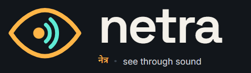
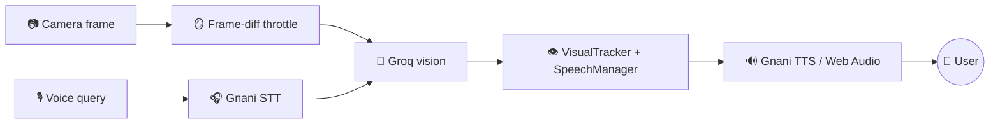

<p align="center">
  
</p>

<h1 align="center">👁️ NETRA — See Through Sound</h1>

<p align="center">
  <b>नेत्र</b> · An AI visual-navigation assistant for blind and visually impaired people.<br/>
  Real-time scene understanding · Voice queries in Indian languages · Directional spatial audio
</p>

<p align="center">
  <a href="https://netra-ai-wuq2.onrender.com/"></a>
  <a href="https://www.gnani.ai/"></a>
  <a href="https://netra-ai-wuq2.onrender.com/api/health"></a>
</p>

<p align="center">
  
  
  
  
  
  
  
  
</p>


---

## 📖 Table of Contents

- [✨ About NETRA](#-about-netra)
- [🚀 Live Demo](#-live-demo)
- [🌟 Key Highlights](#-key-highlights)
- [🎙️ Powered by Gnani.ai](#️-powered-by-gnaniai)
- [🧩 APIs Used & How They Work](#-apis-used--how-they-work)
- [🗂️ Project Structure](#️-project-structure)
- [🔌 Backend API Endpoints](#-backend-api-endpoints)
- [🎮 Controls & Gestures](#-controls--gestures)
- [⚙️ Setup & Environment Variables](#️-setup--environment-variables)
- [🧪 Testing & Validation](#-testing--validation)
- [👩‍💻 Author](#-author)

---

## ✨ About NETRA

**NETRA** (*नेत्र* — "eye" in Sanskrit and Hindi) is an assistive vision, voice-query, and spatial-guidance web application built for blind and visually impaired users. It combines real-time multimodal scene understanding, precision hand-to-target micro-navigation, persistent spatial memory, multilingual voice interaction, and directional spatial audio.

> 🦯 **Please note:** NETRA is an assistive aid. It is designed to work alongside a white cane or guide dog, not to replace them.

---

## 🚀 Live Demo

<p align="center">
  <a href="https://netra-ai-wuq2.onrender.com/"></a>
</p>

1. 📱 Open the link on your phone (recommended) or on a desktop browser with a webcam and microphone.
2. 🔐 Allow **camera** and **microphone** access when prompted. Browsers only grant these over HTTPS, which the live link provides.
3. 👆 Tap the glowing **NETRA** start card (or double-tap the screen, or press `Enter`) to begin scanning.
4. 🎙️ Tap **Query** and ask something like *"Find a chair"*, *"Remember this as my desk"*, or *"Help me make coffee"*.

---

## 🌟 Key Highlights

- 👁️ **Real-Time Visual Navigation:** Continuously analyzes camera frames with social-cue detection, hazard prioritization (`critical` / `high` / `medium` / `low`), clock-direction bearings, and frame-diff throttling (`shouldSkipFrame`) to reduce redundant API calls.
- 🎤 **Mic Query Search (`#micQueryBtn`):** Tap-to-record voice query button with live acoustic wave animations (`@keyframes mic-wave-ring` & `@keyframes mic-wave-bar`) that pauses frame scanning, cancels active playback, and prioritizes user questions.
- 🌐 **Multilingual Voice Pipeline:** Automatically detects the user's spoken or requested language via **Gnani STT v3** (`indic-auto`) and Unicode script detection, propagates the active `SessionState.language` into LLM prompts, and speaks replies via **Gnani TTS (`Nalini`)** across Indian English and Indian regional languages.
- 🎯 **Micro-Navigation Mode:** Guides the user's hand toward fine targets (buttons, switches, handles) using X/Y vectors, stereo-panned tones, and proximity Geiger clicks.
- 🗺️ **Task Planner & Spatial Memory:** Breaks physical requests into step-by-step visual checklists and remembers tagged locations and recently observed objects in `long_term_memory.json`.
- 🛡️ **Resilient Speech & Model Routing:** Uses **Gnani Vachana (`Nalini`)** as the primary voice across frame outputs and inquiry responses (with zero-crash `window.speechSynthesis` fallback) and separates Groq vision vs. text fallback pools with automatic `404`/`400`/`429` handling.

---

## 🎙️ Powered by Gnani.ai

<p align="center">
  <a href="https://www.gnani.ai/"></a>
</p>

NETRA's voice layer is built on **[Gnani.ai](https://www.gnani.ai/)**'s Vachana speech APIs, which are designed for Indian languages:

| 🎧 Capability | Gnani Model | How NETRA uses it |
| :--- | :--- | :--- |
| **Speech-to-Text** | Prisma (`prisma-v3.0`) | Transcribes the user's voice queries, with automatic language detection (`indic-auto`), so a user can ask in their own language. |
| **Text-to-Speech** | Timbre (`timbre-v2.5`, voice `Nalini`) | Speaks navigation alerts, answers and task guidance back to the user in the detected language. |

💙 Thank you to the **Gnani.ai** team for the speech APIs that make NETRA accessible to people across India. Learn more at **[gnani.ai](https://www.gnani.ai/)**.

---

## 🧩 APIs Used & How They Work

| Service / API | Endpoint / Engine | Model / Voice | Role in NETRA |
| :--- | :--- | :--- | :--- |
| 🧠 **Groq Vision & Reasoning** | `https://api.groq.com/openai/v1/chat/completions` | `qwen/qwen3.8-27b` (primary) | Analyzes compressed JPEG camera frames (`224×160` nav / `224×224` micro), classifies inquiry intents, generates task plans, and tracks spatial state in JSON. |
| 🎧 **[Gnani](https://www.gnani.ai/) Vachana STT** | `https://api.vachana.ai/stt/v3` | `prisma-v3.0` (`indic-auto`) | Transcribes 16 kHz mono 16-bit PCM WAV voice queries recorded in the browser and returns `transcript` + `detected_language_code`. |
| 🔊 **[Gnani](https://www.gnani.ai/) Vachana TTS** | `https://api.vachana.ai/api/v1/tts/inference` | `timbre-v2.5` (`Nalini`) | Synthesizes spoken navigation alerts, inquiry answers, and task guidance into 24 kHz linear PCM WAV audio (`base64`), adapting dynamically to the active language (`auto` fallback supported). |
| 🎚️ **Web Audio & Browser Speech** | `AudioContext`, `StereoPannerNode`, `speechSynthesis` | Browser native | Plays directional sonar pings, micro-nav tones, Geiger clicks, queued Gnani WAV clips (`AudioPlayerQueue`), and automatic language-tagged TTS fallback if offline or if Gnani returns no audio. |

### 🔄 How the Pipeline Works



1. 🟢 **Session Start (`POST /api/session/start`):** Initializes the camera stream (with a simulated canvas stream fallback if camera hardware is unavailable), starts Web Audio inside the user gesture, and restores any active task state within 300s.
2. 🔁 **Continuous Frame Loop (`POST /api/frame`):** Captures a downscaled JPEG frame, skips near-identical frames on the client (`src/lib/frame-diff.ts`), and routes the frame on the server (`server/processor.ts`) to `processNavFrame`, `processMicroFrame`, or `processTaskFrame`.
3. 🧹 **Speech Filtering & Tracking (`server/speech.ts`, `server/tracker.ts`):** `VisualTracker` stabilizes object detections across frames using EMA distance smoothing, while `SpeechManager` prevents repetitive announcements via semantic keys and priority-based cooldowns.
4. 🗣️ **Voice Query (`POST /api/inquiry`):** The client records microphone audio (`AudioRecorder` in `src/lib/input.ts`), resamples it offline to 16 kHz mono WAV, and submits it alongside the latest frame. The server transcribes via Gnani STT, detects/updates `session.language`, resolves intent via Groq (`search`, `micro_nav`, `tag`, `task`, `task_*`, `info`, `stop`), synthesizes the spoken response with Gnani TTS (`Nalini`), and returns structured `{ messages: [...] }` JSON.

---

## 🗂️ Project Structure

```text
.
├── index.html                  # HTML entry point, metadata, and Google Fonts (Inter & JetBrains Mono)
├── package.json                # Dependencies and scripts (dev, build, start, test, lint)
├── server.ts                   # Express server entry point (API routes, Vite dev middleware / dist static serving)
├── tsconfig.json               # TypeScript compiler configuration
├── vite.config.ts              # Vite + React + Tailwind CSS configuration
├── .env.example                # Environment variable template
├── long_term_memory.json       # Persisted tagged locations & object history store
├── public/
│   └── assets/aistudio/        # Static branding assets (including start logo image)
├── server/
│   ├── config.ts               # Server secrets, model defaults, intervals, and speech thresholds
│   ├── gnani.ts                # Gnani Vachana STT v3 & TTS client + script language detection
│   ├── llm.ts                  # Groq client with separate vision/text fallback pools & 429 cooldowns
│   ├── memory.ts               # PersistentMemory reader/writer (supports MEMORY_FILE_PATH)
│   ├── processor.ts            # Frame, micro-nav, task, inquiry, and intent handlers
│   ├── prompts.ts              # System prompts for navigation, micro-nav, inquiry, planner, and task guidance
│   ├── session.ts              # SessionState and GlobalTaskState models
│   ├── speech.ts               # SpeechManager priority, escalation, and cooldown logic
│   ├── tracker.ts              # VisualTracker multi-frame confidence & EMA distance smoothing
│   └── netra.test.ts           # Node test suite (17 unit & integration tests)
└── src/
    ├── main.tsx                # React root mount
    ├── App.tsx                 # Main HUD, camera capture loop, Mic Query button, Intel & Task overlays
    ├── styles.css              # OLED dark HUD styling, glowing start card, and recording wave keyframes
    ├── index.css               # Tailwind CSS entry
    └── lib/
        ├── audio.ts            # SpatialAudio synthesizer & AudioPlayerQueue (WAV + speechSynthesis fallback)
        ├── frame-diff.ts       # 16×16 grayscale thumbnail diffing for frame throttling
        ├── input.ts            # Touch/keyboard input listeners & 16 kHz mono WAV AudioRecorder
        └── network.ts          # Server message router & API fetch helpers
```

---

## 🔌 Backend API Endpoints

| Method | Endpoint | Purpose |
| :--- | :--- | :--- |
| `GET` | `/api/health` | Returns `{ ok, hasKey, hasGroqKey, hasGnaniKey }` configuration status. ([try it live](https://netra-ai-wuq2.onrender.com/api/health)) |
| `POST` | `/api/session/start` | Initializes session state, restores recent task plans, and returns timing config. |
| `POST` | `/api/frame` | Processes navigation, micro-navigation, or task-guidance frames (drops overlapping frames). |
| `POST` | `/api/inquiry` | Accepts `{ sessionId, image, audio, audioMime }`, runs Gnani STT + Groq + Gnani TTS. |
| `POST` | `/api/session/end` | Preserves active task state globally and cleans up the ended session. |

---

## 🎮 Controls & Gestures

| 🕹️ Action | How |
| :--- | :--- |
| ▶️ **Start / Stop NETRA** | Tap the glowing **NETRA** start card (`#startBtn`), double-tap the screen, or press `Enter`. |
| 🎙️ **Voice Query Search** | Tap **Query** (`#micQueryBtn`) to start recording (shows active wave bars and acoustic rings), then tap again to send, or hold `Spacebar` on desktop. |
| 🧠 **Intelligence HUD** | Shake device or press `I` to toggle AI reasoning, detected objects, and live telemetry. |
| 🐞 **Debug Console** | 3-finger tap or press `D` to view mirrored logs. |
| ⏱️ **URL Overrides** | Append `?scan=<ms>` (default `15000`) or `?micro=<ms>` (default `2000`) to customize polling intervals, for example [`/?scan=5000`](https://netra-ai-wuq2.onrender.com/?scan=5000). |

---

## ⚙️ Setup & Environment Variables

### 1️⃣ Install & Run Locally

```bash
npm install
cp .env.example .env
npm run dev
```

The app runs on `http://localhost:3000` (Express + Vite middleware in development).

### 2️⃣ Environment Variables

Configure these in `.env` locally, or in your hosting provider's **Environment Variables / Secrets** panel:

```env
# Required API Keys (Server-side only)
GROQ_KEY=your_groq_api_key
GNANI_KEY=your_gnani_api_key

# Optional Configuration (Defaults shown)
GROQ_MODEL=qwen/qwen3.8-27b
GNANI_STT_LANGUAGE=indic-auto
GNANI_TTS_VOICE=Nalini
GNANI_TTS_LANGUAGE=en-IN
GNANI_TTS_MODE=all
# MEMORY_FILE_PATH=/data/long_term_memory.json

PORT=3000
```

- **`GNANI_TTS_MODE`:**
  - `all` *(default)*: Synthesizes all spoken output via Gnani TTS (`Nalini`).
  - `inquiry`: Synthesizes voice query responses only; uses browser `speechSynthesis` for frame alerts.
  - `off`: Disables Gnani TTS and uses browser `speechSynthesis` only.

> 🔑 Get a Gnani API key from [gnani.ai](https://www.gnani.ai/) and a Groq key from [console.groq.com](https://console.groq.com). Keep both server-side and never commit them to the repository.

### 3️⃣ Production Build & Render Deployment

🌍 **Live deployment:** [https://netra-ai-wuq2.onrender.com/](https://netra-ai-wuq2.onrender.com/) (hosted on [Render](https://render.com)).

- **Build Command:** `npm install && npm run build`
- **Start Command:** `npm start` *(binds to `0.0.0.0` using `process.env.PORT` and serves `dist/`)*
- Add `GROQ_KEY` and `GNANI_KEY` in Render's **Environment** tab.
- *(Optional)* Mount a persistent disk and set `MEMORY_FILE_PATH=/data/long_term_memory.json` to preserve tagged locations across redeploys.

---

## 🧪 Testing & Validation

```bash
# Run unit & pipeline tests (17 tests covering SpeechManager, VisualTracker, Groq 429, Gnani STT/TTS & multilingual routing)
npm test

# Run TypeScript typecheck
npm run lint

# Build production client bundle
npm run build
```

---

## 👩‍💻 Author

<p align="center">
  <b>Khushi Kumari</b><br/>
  <i>Designed and built NETRA — see through sound. 👁️🔊</i>
</p>

<p align="center">
  <a href="https://netra-ai-wuq2.onrender.com/"></a>
  <a href="https://www.gnani.ai/"></a>
</p>

<p align="center"><sub>Made with ❤️ for independent navigation.</sub></p>
